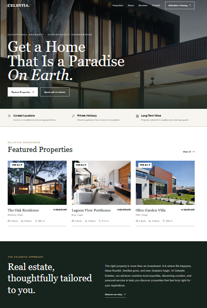
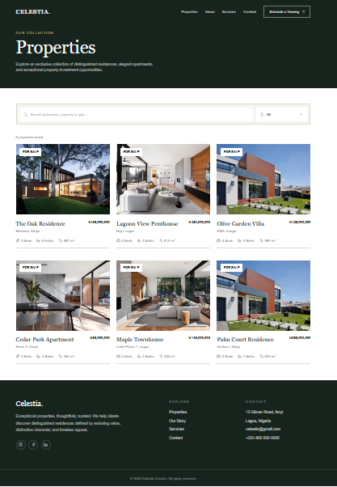
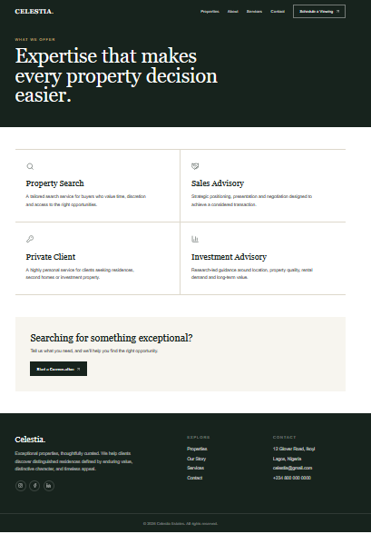

# 🏡 Celestia Estates

### Modern Real Estate. Timeless Elegance.

Celestia Estates is a modern, classic real estate website designed to deliver an elegant property-browsing experience. Built with Next.js, TypeScript, and Tailwind CSS, the platform features responsive layouts, property search and filtering, and dynamic property detail pages.

The project combines sophisticated visual design with a responsive, user-friendly interface for exploring real estate listings.

## ✨ Features

- **Modern Design:** Elegant and professional real estate interface.
- **Responsive Layout:** Optimized for desktop, tablet, and mobile devices.
- **Property Listings:** Browse available properties using demo property data.
- **Search and Filtering:** Find properties using client-side search and filtering.
- **Dynamic Property Pages:** View individual property details through dynamic routes.
- **Reusable Components:** Maintainable UI components for consistent styling.
- **Icon Integration:** Clean interface icons powered by Lucide React.
- **Contact Enquiry Interface:** Frontend contact form UI for property enquiries.

## 🛠️ Tech Stack

- **Framework:** Next.js 16 (App Router)
- **Language:** TypeScript
- **Styling:** Tailwind CSS v4
- **Icons:** Lucide React
- **Development Tools:** Node.js, npm, Git, and GitHub
- **Deployment:** Vercel (recommended)

## 📸 Screenshots

Add screenshots of your website to the `screenshots/` folder in this repository.

### Homepage

### Property Listings

### Property Details

## 👨‍💻 Author

**Emmanuel Alao**  
Full-Stack Web Developer

- **GitHub:** [@emmy-tech247](https://github.com/emmy-tech247)
- **Portfolio:** [View My Portfolio](https://emmanuel-alao-portfolio.vercel.app)

## 📄 License

This project is available for learning and portfolio demonstration. Add a `LICENSE` file to specify the permissions and conditions for reuse.

---

⭐ If you find this project interesting, consider starring the repository.
